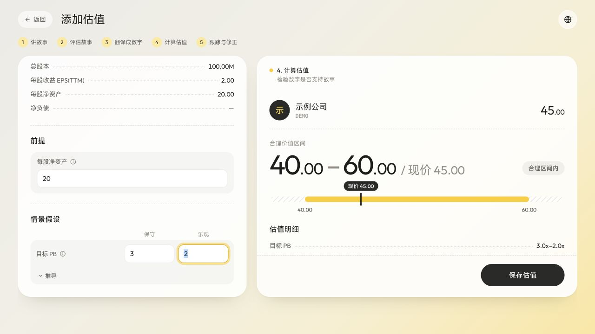

# 从零创建估值：功能与易用性走查

日期：2026-10-20。仅本地审查，未修改应用代码、提交、推送或部署。

## 测试范围

使用桌面浏览器，模拟首次进入标的详情、添加估值、撰写两个场景故事、选择 P/B、修改参数、保存、刷新、再次编辑以及保存失败。使用真实应用路由与隔离的本地 D1；公司、行情及外部 AI 返回均为测试数据。验证的是交互与存储流程，不代表真实 AI 质量、金融数据正确性或所有模型/移动端都已验证。

正常路径：每股净资产 20、保守 PB 2、乐观 PB 3，得到 40–60，保存刷新后两段故事与数值均保留；再次编辑可恢复。AI 起草可以在选择模型前使用，且只填当前场景。

## 发现与建议

### 1. P1：相同参数可以“保存”，但刷新后整张卡消失

复现：填写两段故事 → 选择 P/B → 保持默认保守/乐观 PB 均为 2 → 点击保存。页面退出编辑器，显示 40–40 卡片；刷新后卡片及故事均消失。

原因：编辑器只判断结果有限，允许相等值；宿主页的 cfgSavable 拦下相等区间，saveItem 直接返回，调用方仍退出编辑器。后端也要求 high > low。相关位置：public/shared/valuation-ui.js:711、731；public/index.html:1769、3308；src/items.js:27。

建议：明确支持单点估值还是要求区间，统一前后端校验；任何拒绝保存都要在编辑器内解释，并保留输入。避免让用户为凑区间而随意拉开假设。

### 2. P1：保存失败时仍关闭编辑器，未给出可见重试入口

复现：成功保存 40–60 → 将乐观 PB 改为 4 → 本地模拟 PUT 返回 503 → 点击保存。页面显示 40–80；刷新后恢复 40–60。当前详情页没有可见保存失败提示。

原因：onDone 调用 saveItem 后立即 finishValEdit；保存状态写在其他弹层的 modalSave 元素中。

建议：等待保存成功再退出；失败保留表单并显示“保存失败，重试”，允许安全保留本地草稿。测试结束已关闭故障模拟。

### 3. P1：研究阶段不能单独保存故事草稿

复现：只填保守故事和检验依据 → 点击返回。弹窗提示当前不能计算区间、暂时不能保存；保存按钮禁用，只能继续填写或丢弃。

影响：用户需要分多次研究，当前设计迫使其提前输入数字，违背故事先行的顺序。相关位置：public/index.html:3344–3357。

建议：区分研究草稿和正式估值。草稿可以没有方法、数字或第二个场景，不参与估值钟摆；显示保存状态与继续研究入口。

### 4. P2：故事与数字之间缺少可操作的对应关系

观察：两个不同故事写完后，选择 P/B 自动得到默认 PB 2/2 和价值 40。关键假设仍是自由文本，界面没有提示哪句判断对应哪个参数、默认值是否已确认、参数依据是什么。

影响：用户可能把自动产生的结果理解为故事已被量化；也可能只知道要填数字，却不知道如何从故事推导。

建议：每个场景提供“商业判断 → 财务驱动力 → 参数与依据”的对应记录；区分参考数据、示例默认值和用户确认值。AI 建议先展示推导供确认，再写入参数。不要强制所有文本必填。

### 5. P2：结果排序隐藏了场景方向冲突

复现：每股净资产 20，保守 PB 3、乐观 PB 2。结果显示 40–60 和“合理区间内”，无方向提醒；明细才显示 3.0x–2.0x。

影响：用户可能把 40 当成保守故事结果，实际它来自乐观输入。相关位置：public/shared/valuation-ui.js:523、716。

建议：显示“保守故事对应 60 / 乐观故事对应 40”，保留场景身份；方向异常时提示检查，不要只排序掩盖。在其他模型中应比较场景最终价值，不能一概要求每个参数保守值更小。

### 6. P2：五步顺序不等于五步引导，长页面增加来回寻找

观察：顶部五步是静态文字，没有当前步骤、完成状态或下一步入口；左侧滚动到参数后，场景标签与故事离开视野；验证条件位于右侧敏感性分析之后，又随左侧场景标签切换。

影响：首次使用者需要自己拼出操作顺序，也很难在看着故事时填数，或确认正在给哪个场景写验证条件。

建议：提供轻量的步骤导航和下一步入口，允许回退与跳过；持续显示当前场景，在同一场景上下文中完成故事、检验、参数和验证条件；结果提供两场景对照，敏感性分析可折叠。

## 推荐顺序

先修复保存可信度，再支持研究草稿；随后补齐故事到参数的映射和场景结果身份，最后调整步骤导航及阅读布局。核心目标是让用户能从一个尚未完成的故事开始，逐步验证和量化，随时安全离开与回来。
